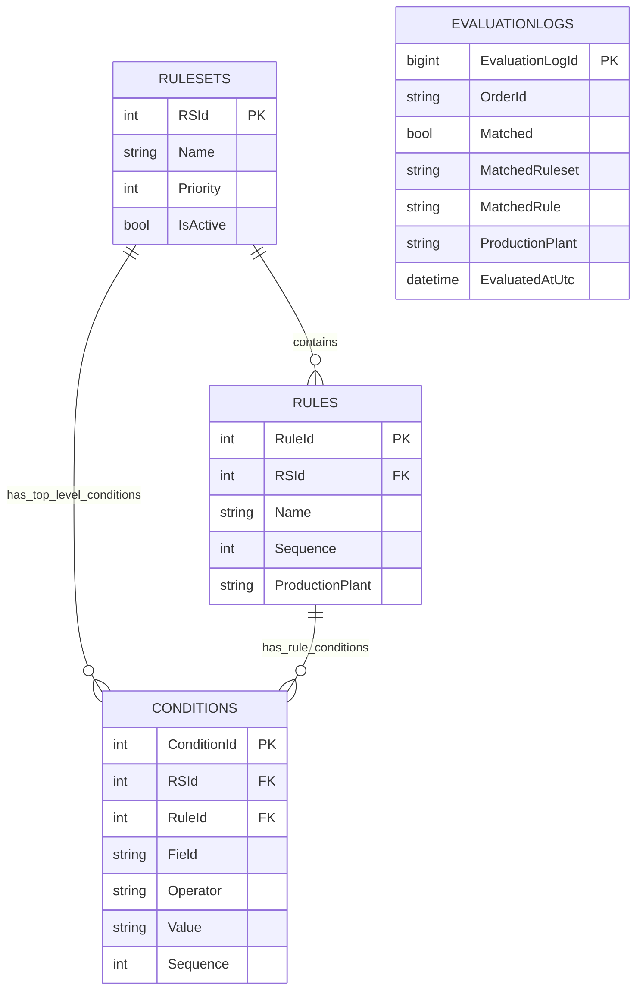

# Database ER Diagram

This diagram shows the main tables used by the rules-based production plant evaluation flow and how they are related.

## Table overview

### 1. Rulesets

Stores each ruleset and its configuration.

- `RSId` is the primary key.
- `Name` identifies the ruleset.
- `Priority` controls the order in which rulesets are evaluated.
- `IsActive` indicates whether the ruleset is available for evaluation.

### 2. Rules

Stores the individual rules that belong to a ruleset.

- `RuleId` is the primary key.
- `RSId` is a foreign key to `RULESETS`.
- `Sequence` controls the order in which rules are checked.
- `ProductionPlant` is the plant returned when the rule matches.

### 3. Conditions

Stores the conditions used by a ruleset or by an individual rule.

- `ConditionId` is the primary key.
- `RSId` identifies a ruleset-level condition.
- `RuleId` identifies a rule-level condition.
- `Field`, `Operator`, and `Value` define what is checked.
- `Sequence` stores the condition order.

A condition is associated with its owning ruleset or rule. The database implementation should make clear which owner applies to each condition.

### 4. EvaluationLogs

Stores the outcome of an evaluation.

- `EvaluationLogId` is the primary key.
- `OrderId` identifies the order that was evaluated.
- `Matched` indicates whether a match was found.
- `MatchedRuleset` and `MatchedRule` record the match, when applicable.
- `ProductionPlant` records the selected plant.
- `EvaluatedAtUtc` records when the evaluation took place.

## Relationship summary

- One ruleset can contain multiple rules.
- One ruleset can have multiple top-level conditions.
- One rule can have multiple rule-level conditions.
- `EVALUATIONLOGS` records evaluation outcomes. No relationship to another table is shown for it in this diagram.
